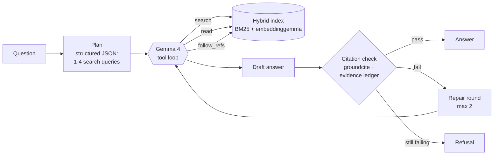

# grounded-rag-agent

[](https://github.com/JafarBanar/grounded-rag-agent/actions/workflows/ci.yml)


An agentic RAG system that runs **entirely on local models** and puts a **checked citation on
every claim, or refuses**.

The agent plans its searches, searches and reads the documents with tools, follows references
from one provision to another, and writes an answer. Code then checks every citation: it must
exist, and the agent must actually have retrieved it during this run. Answers that fail are sent
back for repair; if they still fail, the user gets a refusal, never an unverified answer.

The public demo corpus is the **EU AI Act and the GDPR** (official texts, 2,400 citable
provisions). The same engine runs on private documents, such as your own CV, project notes and
papers, without anything leaving your machine.

```text
$ gra ask eu_ai_law "We use an AI system to rank job applicants. Is it high-risk, and what rights do candidates have under the GDPR?"
  [  1.9s] search({"query": "AI system ranking job applicants high-risk"})
           -> AI Act Annex III(4)(a), AI Act Annex III(4)(b), AI Act Art. 26(7), AI Act Art. 6(3)(d), ...
  [  3.6s] search({"query": "GDPR right automated decisions"})
           -> GDPR Art. 22(1), GDPR Art. 22(4), GDPR Art. 22(3), GDPR Art. 15(1)(h), ...

An AI system used to rank job applicants is high-risk, because the AI Act lists AI systems intended for
the recruitment or selection of natural persons as high-risk [AI Act Annex III(4)(a)]. Under the GDPR,
candidates have the right not to be subject to a decision based solely on automated processing that
produces legal effects or similarly significantly affects them [GDPR Art. 22(1)]. They also have the
right to meaningful information about the logic involved [GDPR Art. 15(1)(h)].

status: answered | cited: AI Act Annex III(4)(a), GDPR Art. 22(1), GDPR Art. 15(1)(h) | 13.0s
```

## Why this project

Most RAG demos retrieve once and trust the model to cite correctly. Two things go wrong in
practice, and both look like correct answers:

1. **One search is not enough.** Legal and technical documents refer to each other. "Is this
   system high-risk?" needs Annex III, then Article 6(2), and maybe the GDPR as well.
2. **Citations are requests, not guarantees.** A model can cite a provision it never read, or add
   a sentence from memory.

This project addresses both: an agent that plans, searches, reads and follows references, and a
citation check in code that turns unsupported answers into refusals. It is measured against a
retrieve-once baseline on the same index, model and check.

## Results

Final run (v3): `gemma4:e4b` on an Apple M3 Pro (18 GB), temperature 0, thinking off, 24 questions.

| Metric | Agent | Retrieve-once RAG |
|---|---|---|
| In-scope questions fully correct (all required provisions cited, check passed) | **95%** | 65% |
| Single-provision questions (10) | 100% | 90% |
| Multi-step questions (6) | 100% | 67% |
| Questions needing both acts (4) | 75% | 0% |
| Required provisions retrieved | 100% | 78% |
| Out-of-scope questions refused (4) | 100% | 100% |
| Answered but missing a required provision (of 20) | 0 | 6 |
| Seconds per question, mean / 95th percentile | 15.7 / 27.8 | 5.0 / 8.1 |
| Model calls / tool calls per question | 5.8 / 3.4 | 1 / 0 |
| Tokens per question | 8,699 | 1,374 |

The agent costs about 3x the time and 6x the tokens of one retrieval, and buys most of its gain on questions that need more than one provision. The one in-scope question it got wrong ended in a refusal, not a wrong answer.

### How it got there

Each version was evaluated on the same 24 questions; the failures were read one by one and fixed at the root.

| Version | Agent fully correct | Baseline | What changed, and why |
|---|---|---|---|
| v1 | 50% | 45% | First complete system. Failures: the model put several ids in one bracket (`[Art. 27(1)(a), Art. 27(1)(b)]`), which the check read as invented; articles without paragraphs (the dates in Art. 113) were not searchable; definitions were hard to find by keyword. |
| v2 | 80% | 60% | Multi-id brackets expanded and checked one by one; leaf articles searchable; definitions titled by their term; light stemming; the top two results of each search method always kept. A guard now stops the index if stored vectors do not match the searchable units (a misalignment bug found here). |
| v3 | 95% | 65% | A planning step (structured JSON search plan) fixed incomplete exploration on two-part questions; every lettered point became citable (`Art. 113(a)`); two repair rounds. |

Tuning stopped at v3: further changes against the same 24 questions would fit the test set rather than improve the system. The next step is a larger, independently written question set.

Full reports: [`eval/results/`](eval/results/).

## How it works



| Part | What it does |
|---|---|
| **Ingest** | Parses the official EU XHTML into units with exact legal citations: `AI Act Art. 6(2)`, `AI Act Art. 5(1)(f)`, `AI Act Annex III(4)(a)`, `GDPR Art. 4(11)`, recitals. Definitions are titled by their term. Cross-references such as "Article 9 of Regulation (EU) 2016/679" are resolved to the right act. Private Markdown, Word and PDF files become units like `master-cv.md §Experience` and `paper.pdf p.3`. |
| **Hybrid search** | BM25 (keeps codes like `2016/679`, light stemming so "application" matches "apply") fused with `embeddinggemma` vectors by reciprocal-rank fusion; the top two of each method are always kept. |
| **Plan** | One structured-output call (JSON schema) splits the question into 1 to 4 search queries. |
| **Tool loop** | Native tool calling with Gemma 4 through Ollama: `search`, `read` (a provision or a whole article), `follow_refs`. Budgets: 12 tool calls, 8 model steps. |
| **Citation check** | Every `[id]` must exist in the corpus and be in the evidence ledger (what the tools returned this run); at least 80% of factual sentences must carry a citation, counted with my package [`groundcite`](https://github.com/JafarBanar/groundcite). Lists like `[Art. 6(3)(a), (b)]` are expanded and checked one by one. |
| **Refusal** | Out-of-scope questions get `NOT FOUND`; answers that cannot be fixed get a refusal that lists the provisions checked. |
| **Interfaces** | CLI, a web app that streams each agent step and opens the cited text, an MCP server, and JSONL traces with timings and token counts. |

More detail: [docs/architecture.md](docs/architecture.md).

## Quick start

Requirements: Python 3.10+, [Ollama](https://ollama.com), about 8 GB free memory.

```bash
ollama pull gemma4:e4b
ollama pull embeddinggemma

git clone https://github.com/JafarBanar/grounded-rag-agent
cd grounded-rag-agent
python -m venv .venv && source .venv/bin/activate
pip install -e ".[dev]"

scripts/download_eu_texts.sh        # official AI Act and GDPR from the EU Publications Office
gra build eu_ai_law                 # parse, resolve references, embed (about 40 s on an M3)
gra ask eu_ai_law "Is emotion recognition at work allowed under the AI Act?"
gra serve                           # web app on http://127.0.0.1:8000
gra eval eu_ai_law                  # 24 questions, agent vs retrieve-once baseline
```

### Your own documents

```bash
cp corpora/private.example.yaml corpora/private.yaml   # git-ignored
# edit the paths, then:
gra build private
gra ask private "Which of my projects show experience with LangGraph?"
gra serve --corpus eu_ai_law,private
```

The private corpus config tells the agent to state only what the documents show, so it is
useful for checking claims before they go into an application or a report.

### MCP

`gra mcp eu_ai_law` serves `search`, `read`, `follow_refs` and `ask` over stdio, so Claude
Desktop, an IDE or another agent can use the corpus and the checked agent as tools.

## Evaluation method

* 24 questions in [`eval/questions_eu.yaml`](eval/questions_eu.yaml): 10 single-provision, 6
  multi-step, 4 that need both acts, and 4 out-of-scope questions that must be refused.
* Each in-scope question lists the provisions a correct answer must cite. A question is **fully
  correct** only when the answer passes the citation check and cites every required provision
  (or a paragraph or point inside it).
* Both systems use the same index, model (`gemma4:e4b`, temperature 0, thinking off) and citation
  check. The baseline retrieves the top 8 provisions once and makes one model call.
* Honest limits: the questions and the expected citations were written by the author, so the
  scores are optimistic; 24 questions is a small set, so one question is about 5 points; and the
  check verifies that cited provisions were retrieved, not that every sentence is a faithful
  reading of them.

## Project layout

```text
src/grounded_agent/
  ingest/eurlex.py   EU act parser (articles, paragraphs, points, annexes, recitals)
  ingest/files.py    Markdown, Word and PDF loader for private corpora
  ingest/refs.py     cross-reference detection and resolution
  index.py           BM25 + dense vectors + fusion
  tools.py           search, read, follow_refs, and the evidence ledger
  agent.py           plan, tool loop, repair, refusal, traces
  citations.py       citation check built on groundcite
  baseline.py        retrieve-once RAG for comparison
  evaluate.py        scoring and reports
  server.py          FastAPI + server-sent events web app
  mcp_server.py      MCP server
web/index.html       single-page UI
eval/                questions and results (v1, v2, v3 kept to show the iterations)
```

## License

MIT. The EU legal texts are not included; the download script fetches them from the EU
Publications Office (reuse of EU legislation is permitted under Commission Decision
2011/833/EU).
